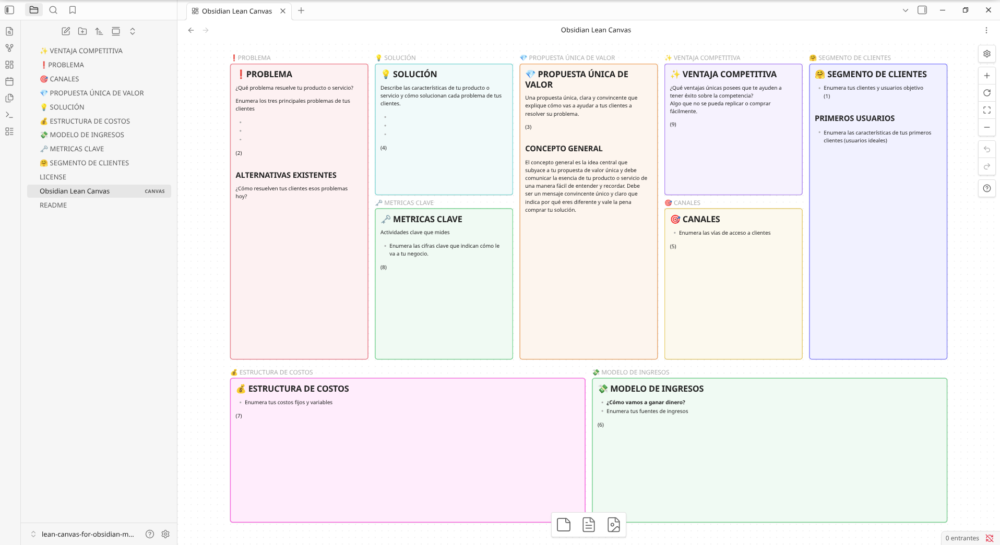

# Plantilla Lean Canvas para Obsidian

Una plantilla del **Lean Canvas** de Ash Maurya adaptada para **Obsidian**, diseñada para ayudarte a documentar y desarrollar tu modelo de negocio utilizando archivos Markdown y Canvas.

Esta plantilla está basada en el modelo Lean Canvas de Ash Maurya:
https://blog.leanstack.com/what-is-the-right-fill-order-for-a-lean-canvas/

## Vista previa

## Características

- 📋 Plantilla lista para usar en Obsidian.
- 📝 Cada bloque del Lean Canvas corresponde a un archivo Markdown independiente.
- 🎨 Incluye un archivo `.canvas` con la disposición completa del lienzo.
- 📤 Compatible con la exportación a PNG. Para PDF y otros formato usar plugins.
- 🇪🇸 Traducción y adaptación al español de una plantilla original en inglés.

## Requisitos

Antes de comenzar necesitas tener instalado **Obsidian**.

👉 https://obsidian.md

## Instalación

1. Descarga este repositorio desde GitHub.
2. Descomprime la carpeta `lean-canvas-obsidian`.
3. Abre Obsidian.
4. Selecciona **"Abrir una carpeta como bóveda"**.
5. Elige la carpeta `lean-canvas-obsidian`.

¡Listo! Ya puedes comenzar a construir tu Lean Canvas.

## Cómo utilizar la plantilla

La plantilla está organizada en varios archivos Markdown, uno por cada bloque del modelo Lean Canvas:

- Problema
- Segmentos de clientes
- Propuesta única de valor
- Solución
- Canales
- Fuentes de ingresos
- Estructura de costos
- Métricas clave
- Ventaja competitiva

Todos estos archivos se encuentran enlazados dentro del archivo `Lean Canvas.canvas`.

Puedes trabajar de dos maneras:

- Editando cada archivo Markdown por separado.
- Escribiendo directamente sobre el lienzo desde el archivo `.canvas`.

## Exportar el lienzo

El archivo Canvas puede exportarse directamente como imagen PNG desde Obsidian.

Si deseas generar un PDF u otros formatos, puedes utilizar alguno de estos complementos:

- [Canvas to PDF](https://community.obsidian.md/plugins/canvas-to-pdf)
- [Canvas Export](https://community.obsidian.md/plugins/canvas-export)

## Créditos

Esta plantilla es una **traducción y adaptación al español** de la plantilla original en inglés:

https://github.com/YJPL/lean-canvas-for-obsidian

Todo el mérito del diseño original corresponde a sus autores.

## Contribuciones

Si encuentras algún error, tienes una sugerencia o quieres mejorar la plantilla, no dudes en abrir un **Issue** o enviar un **Pull Request**.

Toda contribución es bienvenida.

## Licencia

Consulta el archivo `LICENSE` para conocer los términos de uso de esta plantilla.

---

⭐ Si esta plantilla te resulta útil, considera darle una **estrella al repositorio**. Es una forma sencilla de apoyar el proyecto y ayuda a que más personas puedan encontrarlo.

También puedes compartirla con otros emprendedores, estudiantes o equipos que utilicen **Obsidian** para diseñar y validar modelos de negocio.